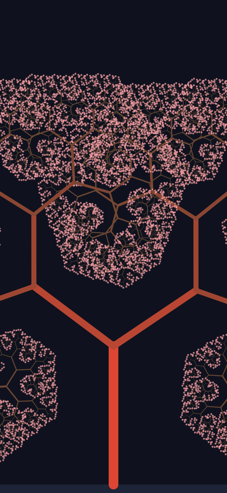

# Processing Workspace

Creative-coding workspace for [Processing](https://processing.org), using a
**portable install** of Processing 4.5.7 (Windows x64). No admin rights were
needed; nothing was installed into Program Files or the registry.



## Layout

```
C:\Users\dybvig\Coding\Processing\
├── Processing\                  Portable Processing IDE (extracted from the zip)
│   ├── Processing.exe           Launch the IDE
│   └── app\resources\jdk\bin\   Bundled JDK (javac / java) used by the IDE
├── demo\demo.pde                Flow-field particle demo
├── colors\colors.pde            HSB color wheel / ramps / lerpColor demo
├── robot\robot.pde              Robot arm / inverse-kinematics demo
├── tree\tree.pde                Fractal tree with wind + pentatonic chimes
├── FractalTree.apk              Signed APK of the tree sketch (see ANDROID.md)
├── android-build\               Android SDK, toolchain, and build project
└── README.md / AGENTS.md        Docs for humans and agents
```

## Running sketches

- **IDE**: run `Processing\Processing.exe`, open a sketch, press Ctrl+R.
- **Command line**: the portable build does *not* include `processing-java`.
  To run without the IDE, compile a Java-mode class against the core jar:

  ```
  Processing\app\resources\jdk\bin\javac.exe -cp Processing\app\core-4.5.7-*.jar MySketch.java
  Processing\app\resources\jdk\bin\java.exe  -cp Processing\app\core-4.5.7-*.jar;. MySketch
  ```

  The Java-mode class must extend `processing.core.PApplet` and call
  `PApplet.main("ClassName")` from `main`.

## Sketchbook

The IDE's sketchbook is
`C:\Users\dybvig\OneDrive - NTNU\Documents\Processing` — note Documents is
**OneDrive-redirected**, so the plain `C:\Users\dybvig\Documents\Processing`
path is *not* the sketchbook. The authoritative path is `sketchbook.path.four`
in `%APPDATA%\Processing\preferences.txt`. Copies of all sketches live
there too. Two locations only: the sketchbook (what the IDE opens) and this
directory (baseline/testing copies) — keep them in sync when a sketch
changes. The IDE only scans the sketchbook at startup, so new folders appear
in File → Sketchbook after a restart.

## Sound

The **Sound library** (v2.4.0) is installed at
`sketchbook\libraries\sound\` — placed there manually from
https://github.com/processing/processing-sound/releases, since Processing 4
otherwise downloads it on first import. Import with
`import processing.sound.*;`. Note: in Sound 2.x the `Noise` class is
abstract — use `WhiteNoise`, `PinkNoise`, or `BrownNoise`.

## Later: Android & Google Play (tips)

- **Processing for Android** is an official mode: same `setup()`/`draw()`
  code, exported as an APK. Install via the IDE's mode selector; first use
  downloads the Android SDK (~1 GB+). `size()` becomes `fullScreen()`, mouse
  events map to touch; sensors/camera/multi-touch come via the **Ketai**
  library.
- **Cheapest experiment**: build an APK of an existing sketch and sideload
  it on a phone (USB debugging). No store account needed — tells you how the
  code feels on touch before any investment. **Already done here**: the tree
  sketch ships as `FractalTree.apk`, built headlessly — see `ANDROID.md`
  for the pipeline and `AGENTS.md` for the verify-in-emulator rule.
- **Sideloading these days**:
  - No-cable way: copy the APK to the phone (Drive/email/download), tap it
    in Files; Android asks to allow *that specific app* to install unknown
    apps (Settings → Apps → Special access → Install unknown apps), then tap
    the APK again. Permission is per-app, not global.
  - Developer way: About phone → tap Build number 7x → Developer options →
    USB debugging → plug in, accept the fingerprint dialog → `adb install
    app.apk` (adb = Android SDK platform-tools, small standalone download).
  - Android 10+ supports wireless ADB: Developer options → Wireless
    debugging → `adb pair <ip:port>` with the on-screen code, then `adb
    connect` — installs over Wi-Fi, no cable.
  - Gotchas: Play Protect may warn on sideloaded APKs (overridable; proper
    signing reduces friction), and APKs targeting very old API levels are
    refused by recent Android versions.
  - With Android Mode, "Run on device" does the adb dance automatically once
    USB debugging is enabled; manual `adb install` is only for separately
    exported APKs.
- **Google Play hurdles** if publishing for real:
  - Developer account: $25 one-time.
  - Play requires **App Bundle (AAB)** for new apps; Android Mode exports
    APKs, so expect to wrangle the generated Gradle project for AAB.
  - Play requires targeting a recent Android API; check the mode's
    toolchain version against the current requirement first.
  - Store listing work is on you: screenshots, content rating, privacy
    policy, Data safety form.
- **Engine choice**: Processing suits sketch-like/artistic 2D games;
  **libGDX** (also Java, similar feel) is the production-ready path with AAB
  and multi-platform support; Godot/Unity have store tooling built in.
  Pragmatic route: prototype in Processing, port the logic to libGDX for the
  Play release.
- **Alternative for "sketches on a phone"**: p5.js in a mobile browser — no
  SDK, no APK, just a web page.

## Android build (done once, reusable)

A signed APK of the tree sketch exists at `FractalTree.apk` (2.6 MB — the
Sound library is dexed in, minSdk 24, targetSdk 33, signed with a local
debug key). The full pipeline,
versions, and gotchas are documented in **ANDROID.md**; the short version:

- Toolchain in `android-build\`: Android cmdline-tools + platform 33 +
  build-tools 33.0.2, plus Processing's Android core jarred from the
  AndroidMode release.
- Pipeline: `aapt2 link` → `javac --release 8` → `d8` → `zipalign` →
  `apksigner` (invoke d8/apksigner via `java -cp`, their `.bat` wrappers are
  broken on modern JDKs).
- Install: enable USB debugging (or per-app "install unknown apps"), then
  `adb install FractalTree.apk` or tap the APK in Files.

Not yet done: sound (needs the Android Sound library dexed in), icons,
AAB conversion for Play.

## Gotchas

- **Sketch folder name must match the `.pde` filename** (`demo\demo.pde`,
  not `mystuff\demo.pde`), or Processing refuses to open it.
- **Reserved words can't be sketch names** — e.g. a sketch cannot be called
  `color`. Use `colors`, `colorwheel`, etc.
- **GUI apps launched from a shell stay attached** to that shell until the
  window closes; a "timeout" while launching `Processing.exe` is usually the
  shell waiting on the GUI, not a failure.
- **The IDE does not hot-reload config or the sketchbook** while running.
- The original portable zip was deleted after extraction. To re-install or
  update, download a portable zip from
  https://github.com/processing/processing4/releases and extract over (or
  beside) `Processing\`.
